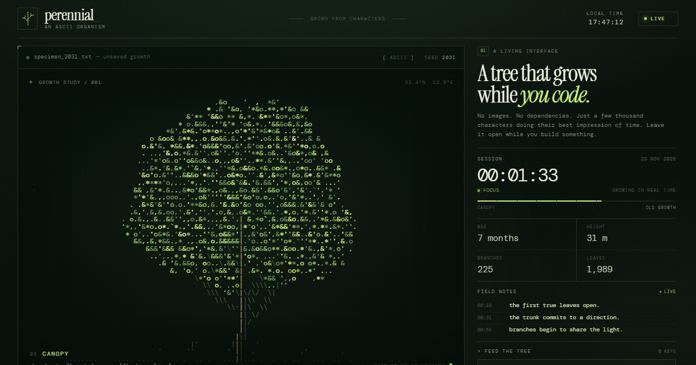

# Perennial

**A live ASCII tree that grows while you code.**

[**Live site → coding-plant.vercel.app**](https://coding-plant.vercel.app/)

Perennial is a small, dependency-free web experiment: a procedural tree drawn entirely with characters, growing in real time from a single seed. It has become a slow, ambient piece — eight focused hours to a full canopy, with the light and air changing around it while you work.



## What it does

- Grows a new, deterministic ASCII specimen from a seed.
- Keeps growing in real time — from germination through canopy to old growth.
- Grows deliberately slowly: a full canopy takes about eight hours of focused time.
- Follows the local sky through dawn, day, dusk, and night, with a matching tree palette and fireflies after dark.
- Shows the next lifecycle stage, an ETA, ring count, and total tended time.
- Has a distraction-free **focus mode** (the expand button, or press `F`).
- Persists locally in `localStorage`, so the same tree is waiting when you return.
- Feeds on keystrokes: typing accelerates growth and releases a small shower of nutrients.
- Pauses, resumes, reseeds, and exports the current ASCII tree as plain text.
- Responsive, keyboard accessible, and respectful of `prefers-reduced-motion`.

No images, no frameworks, no analytics. The tree is drawn character by character on a canvas and echoed as plain text.

## VS Code integration

The [`vscode-extension`](vscode-extension) folder contains a companion extension that connects the tree to actual VS Code time. It tracks focused VS Code time, keeps the tree across editor restarts, shows a status bar clock, and opens the same interface in a webview. The tree still starts as a seed; it just starts the moment you do.

```bash
cd vscode-extension
npm run sync-media
npm run package
code --install-extension perennial-vscode-0.2.0.vsix
```

On first install the extension opens the tree automatically. Afterwards, use the **Perennial** status bar item or the **Perennial: Open Tree** command. The webview shows **VS CODE** in the live chip while it is connected.

The browser site continues to work on its own and uses local browser time. The extension is the bridge for real editor time.

## Run it locally

Requires Node.js 20 or newer.

```bash
npm run dev
```

Then open [http://127.0.0.1:4173](http://127.0.0.1:4173). There are no dependencies to install.

## Controls

| Control | Effect |
| --- | --- |
| **Feed the tree** | Every character adds a little growth and a bright burst of nutrients |
| **Pause growth** | Freezes the session clock and the tree |
| **New seed** | Confirms, then plants a new specimen |
| **Focus mode** | Hides everything but the tree — the expand button or `F` |
| **Copy ASCII** | Copies the current tree and session details to the clipboard |
| **Save .txt** | Downloads the current tree as plain text |

Session state lives only in your browser under `perennial.session.v4`. Typed text is never stored — only the number of keys offered. In the VS Code extension, session state lives in VS Code's global extension storage instead.

Perennial is deliberately slow. The seed stage lasts about twenty seconds; the first true leaves usually arrive after ten minutes; a full canopy takes roughly eight hours of focused time. The tree is designed to be left open across whole workdays, not watched for a minute.

## How it works

`tree.js` is a seeded, deterministic branching system. A central trunk rises through several layers of limbs; each limb fans into smaller branches and leaf clusters. Branch birth times are absolute, so any moment in the tree's life can be reconstructed from the seed and elapsed time. `main.js` renders the result to a character grid on a canvas, layers in ambient foliage while the tree is young, follows the local sky through four palettes, and handles the slow growth clock, focus mode, local persistence, and interactions.

The palette is a small set of translucent phosphor greens, warm wood tones, and a single amber for blossom season. It shifts subtly with the time of day.

## Deploy

The site is static, so it deploys anywhere. The included `vercel.json` adds security headers and clean URLs; a Vercel deployment needs no build step.

## License

[MIT](LICENSE)
